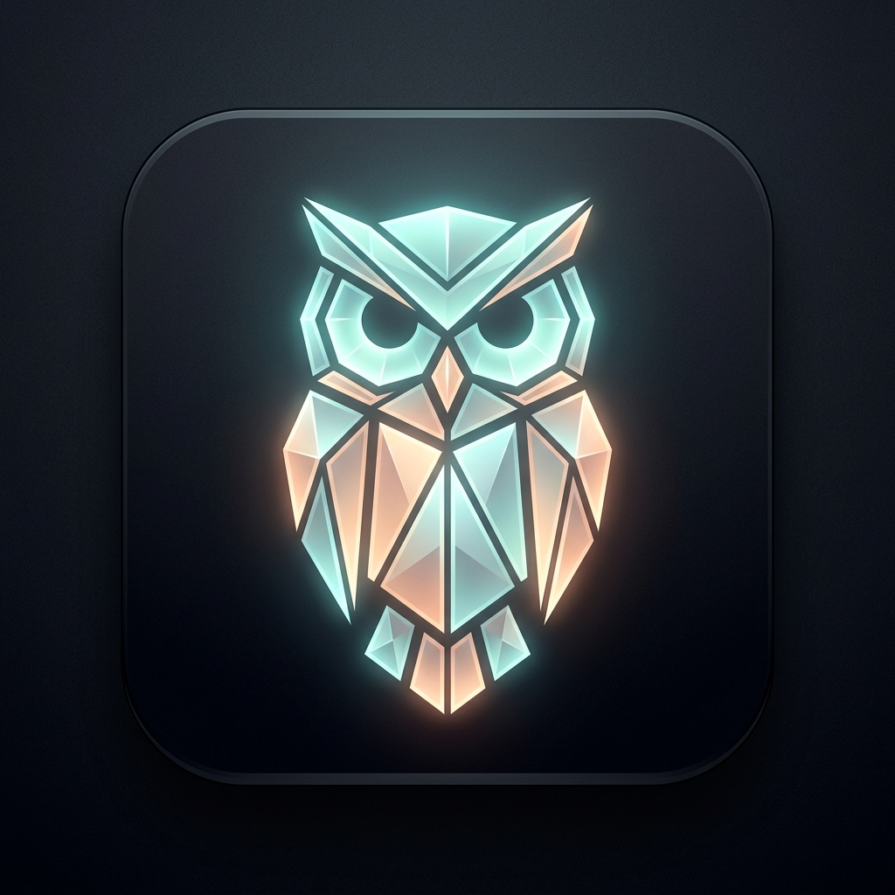
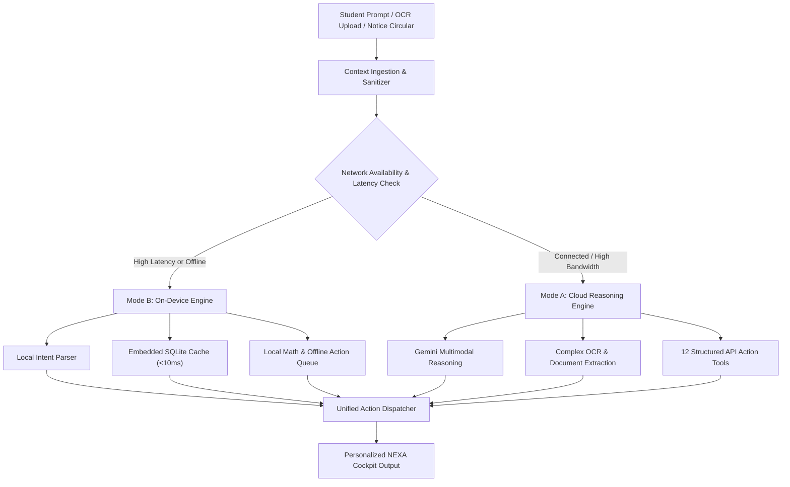

<div align="center">

  

  # NEXA
  ### Nexa Intelligent AI
  **The Autonomous Intelligence Layer & Operating System for Academic Life**

  <p align="center">
    <em>"Less remembering. Less searching. Less switching. More doing."</em>
  </p>

  [](https://github.com/Kshaurya-07/NEXA)
  [](https://vitejs.dev/)
  [](https://react.dev/)
  [](https://tailwindcss.com/)
  [](#-the-dual-engine-cognitive-architecture)
  [](https://github.com/kunal4060/GLITCHERS)
  [](LICENSE)

  <br/>

  <a href="https://drive.google.com/drive/folders/1FTWEF3Nv-DdVrEB-r9dI_ydVPCRpv3xD">
    
  </a>

</div>

---

## 📑 Table of Contents

- [Overview & Vision](#-overview--vision)
- [The Relationship: NEXA vs. NIA](#-the-relationship-nexa-vs-nia)
- [The Dual-Engine Cognitive Architecture](#-the-dual-engine-cognitive-architecture)
- [14 Unified Pillars of Student Life](#-14-unified-pillars-of-student-life)
- [Interactive Spatial Features & 3D Cockpit](#-interactive-spatial-features--3d-cockpit)
- [6-Layer 3D Global Canvas Environment](#-6-layer-3d-global-canvas-environment)
- [Communication & Support Protocol](#-communication--support-protocol)
- [Built by Team Glitchers](#-built-by-team-glitchers)
- [Tech Stack](#-tech-stack)
- [Project Directory Structure](#-project-directory-structure)
- [Getting Started](#-getting-started)
- [Deployment Instructions (Render, Vercel, Netlify)](#-deployment-instructions)
- [Official Links & Resources](#-official-links--resources)

---

## 🌌 Overview & Vision

University students navigate an intensely fragmented digital ecosystem. Key academic alerts arrive across chaotic WhatsApp group chats, buried university portal circulars, screenshots of schedules, cluttered Google Drive folders, and unorganized note apps. Important deadlines are missed, attendance drops below required thresholds, and group finances create social friction.

**NEXA** is a spatial, mobile-first student operating system engineered to eliminate student cognitive friction. Powered by **NIA** (*Nexa Intelligent Assistance*), NEXA fuses personal schedules, academic syllabi, financial ledgers, and institutional notices into a unified autonomous cockpit.

---

## ⚡ The Relationship: NEXA vs. NIA

```
┌────────────────────────────────────────────────────────────────────────┐
│                        NEXA (The Platform)                             │
│     Mobile OS • Unified UI • 3D Spatial Cockpit • Calendar • Finance    │
└───────────────────────────────────┬────────────────────────────────────┘
                                    │
                                    ▼ Powered by
┌────────────────────────────────────────────────────────────────────────┐
│                        NIA (The Intelligence)                          │
│   Autonomous Cognitive Engine • Dual Router • OCR & Context Parsing    │
└────────────────────────────────────────────────────────────────────────┘
```

- **NIA** is the autonomous cognitive engine — the brain that reads syllabi, distills circulars, balances ledgers, monitors attendance, and proactively suggests schedule adjustments.
- **NEXA** is the physical surface and platform where NIA lives — providing students with calm, one-thumb mobile workflows and high-speed execution.

---

## 🧠 The Dual-Engine Cognitive Architecture

NIA operates under a unified design philosophy: **"One Assistant. Two Ways to Think."**



### Mode A: Connected / Cloud Mode
- **Multimodal Cloud Reasoning**: High-order analytical synthesis powered by Gemini models for nuanced semantic understanding.
- **Computer Vision & OCR**: Parsing complex, hand-written, or skewed timetable images and lengthy syllabi.
- **12 External Tools**: Deep integrations with student email, cloud backups, and institutional portals.

### Mode B: Offline / On-Device Mode
- **Sub-10ms Local Execution**: Instant timetable lookups, class schedules, and attendance calculations with zero internet dependency.
- **Embedded Intent Parser**: Offline regex and intent-tree processing for rapid schedule queries (*"What's my next lecture?"*).
- **Resilient Offline Action Queue**: Financial spends and tasks logged without connectivity are automatically queued and synchronized upon reconnection.
- **Zero Telemetry**: All core academic personal records remain encrypted on-device.

---

## 🏛 14 Unified Pillars of Student Life

NEXA replaces fragmented single-purpose apps with a single, calm platform:

1. **University Gmail Distiller**: 400-word confusing administrative circulars distilled into 3 actionable bullet points.
2. **Timetable & Schedule Matrix**: Class schedule tracking with room numbers, professor details, and real-time next-class countdowns.
3. **Attendance Guard (75% Rule)**: Real-time attendance percentage tracking with "Safe Bunks Remaining" calculations.
4. **Task Manager & Deadlines**: Priority-ranked tasks with smart study sprint scheduling during student free periods.
5. **Exam Countdown & Hall Ticket Hub**: Direct links to examination guidelines, datesheets, and seat allocations.
6. **Assignments & Lab Reports**: Multi-course assignment tracking with deadline countdowns and submission reminders.
7. **Academic Calendar Sync**: University semester breaks, holiday schedules, and mid-sem assessment dates.
8. **Campus Spend Logger**: Natural language expense logging (*"Spent ₹180 at Food Street"*) with auto-categorization.
9. **Monthly Budget Runway**: Visual pacing to alert students when spend velocity exceeds daily allowance.
10. **Borrow & Lend Ledger**: Frictionless ledger tracking who owes what to eliminate awkward financial conversations.
11. **Shared Bill Splitter**: Group dining and room expense splitter with instant UPI 1-tap settlement.
12. **Document & Notes Vault**: Centralized storage for ID cards, hall tickets, and syllabus PDFs.
13. **Contextual Campus Search**: Universal cross-app search across emails, notes, tasks, and timetables.
14. **Smart Notification Feed**: Non-intrusive, proactive alerts dispatched at the exact right time (*"DBMS starts in 10 mins in Room 302"*).

---

## 🎮 Interactive Spatial Features & 3D Cockpit

The web application features an interactive 3D mobile simulation cockpit:

- **Interactive 3D Phone Tilt**: Realistic mouse-tracking perspective transforms simulating the actual NEXA mobile app interface.
- **Timetable OCR Simulator**: Upload test timetable photos and watch real-time OCR extraction populate your schedule.
- **Live Bill Splitter**: Adjust group spend amounts and student participant counters to calculate real-time per-head splits and UPI settlements.
- **Priority Task Completer**: Check off critical tasks and view instant recalculation of pending academic workloads.
- **15 Contextual 3D Overlays**: Click any feature card across the platform to launch a dedicated spatial cockpit overlay with live calculation controls and architectural specifications.
- **Connected Cascade Pipeline**: Visual demonstration showing how an incoming university email automatically triggers deadline extraction, task creation, calendar reservation, and proactive push notifications.

---

## 🌐 6-Layer 3D Global Canvas Environment

The entire web platform is immersed within a hardware-accelerated 60fps HTML5 Canvas 2D / 3D environment (`BackgroundNetwork.jsx`):

1. **Layer 1: Spatial Perspective Grid**: Infinite vanishing floor and horizon lines reacting to vertical scroll depth.
2. **Layer 2: Digital Dust Particle Field**: Floating 3D particles drifting along randomized 3-axis vectors with subtle parallax.
3. **Layer 3: Floating Wireframe Polyhedrons**: Mathematical 3D shapes (Tetrahedrons, Octahedrons, Crystalline Meshes, Dodecahedrons, and Orbital Rings) rendered with smooth 3D rotation matrices.
4. **Layer 4: Animated Data Packet Streams**: Luminous energy packets traversing polygon edges dynamically.
5. **Layer 5: Volumetric Spatial Lights**: Radial lighting gradients producing cinematic cyan, teal, and graphite glows.
6. **Layer 6: Holographic HUD Floating Fragments**: Translucent contextual telemetry tags hovering in 3D perspective.

---

## 📡 Communication & Support Protocol

The website includes a direct communication system for inquiries, bug reports, and collaboration:

- **Endpoint**: Direct dispatch relay to `kshaurya0708@gmail.com` via FormSubmit AJAX.
- **Input Validation**: Rigorous client-side verification ensuring valid names, detailed queries, and at least one contact method (email or phone).
- **Fail-Safe Mechanism**: Automatic direct `mailto:` fallback pre-populated with form details if network blockers or adblockers interrupt the API request.

---

## 🛠 Built by Team Glitchers

NEXA and NIA are envisioned, designed, and engineered by **Team Glitchers** — an independent collective of systems engineers, AI researchers, and interface designers dedicated to engineering frictionless tools for academic life.

- **Autonomous Cognition**: Multimodal student context modeling, intent parsing, and dual-engine synchronization.
- **Spatial Product Design**: Calm computing aesthetics, one-thumb mobile workflows, and glass depth design.
- **On-Device Systems**: Local embedded storage, zero-cloud timetable resolution, and background action queues.
- **Student Privacy Engineering**: Zero ad-tech integrations, zero third-party telemetry, and client-side encryption.

Learn more about Team Glitchers:
- [GitHub Organization: kunal4060/GLITCHERS](https://github.com/kunal4060/GLITCHERS)

---

## 💻 Tech Stack

| Category | Technology |
|---|---|
| **Frontend Framework** | React 18 (Functional Components, Custom Hooks) |
| **Build Tool & Bundler** | Vite 5 (Lightning-fast HMR, Tree-shaking, Rollup bundling) |
| **Styling & Design System** | Tailwind CSS 3.4 (Custom glassmorphism, responsive breakpoints) |
| **3D & Canvas Graphics** | HTML5 Canvas 2D Context + Custom 3D Projection Matrices |
| **Icons & Visual Language** | Lucide React |
| **Form Transmission** | FormSubmit AJAX Relay + Mailto Fallback |
| **Typography** | Syncopate (Futuristic Display) + JetBrains Mono / Space Mono |

---

## 📂 Project Directory Structure

```
NEXA/
├── public/
│   ├── favicon.ico             # Application icon
│   └── logo.png                # Official NEXA Owl Brand Logo
├── src/
│   ├── components/
│   │   ├── shared/
│   │   │   ├── BackgroundNetwork.jsx   # 6-layer 3D floating canvas system
│   │   │   └── Card3D.jsx              # Reusable 3D tilt component with specular glare
│   │   ├── AboutSection.jsx            # "Built by Team Glitchers" collective overview
│   │   ├── ContactSection.jsx          # Direct communication dispatch to kshaurya0708@gmail.com
│   │   ├── DemoVideo.jsx               # Cinematic 3D embedded product demo video
│   │   ├── DownloadSection.jsx         # Official Android APK download hub & QR scanner
│   │   ├── EverythingConnected.jsx     # Autonomous 5-stage cascade pipeline
│   │   ├── FeatureModal.jsx            # 15 interactive 3D spatial feature cockpits
│   │   ├── FeaturesShowcase.jsx        # Interactive 3D phone simulation & deep-dive panels
│   │   ├── FloatingAssistantWidget.jsx # Persistent floating quick-access HUD widget
│   │   ├── Footer.jsx                  # Brand lockup, official links & navigation
│   │   ├── Header.jsx                  # Sticky frosted glass navigation with scroll locks
│   │   ├── HeroNia.jsx                 # Futuristic hero section with 3D logo showcase
│   │   ├── NexaAppIntro.jsx            # 14 pillars breakdown & student problem transformation
│   │   ├── NiaArchitecture.jsx         # 5-step processing pipeline & dual router visualizer
│   │   ├── NiaCapabilities.jsx         # 11 core capabilities of the NIA cognitive engine
│   │   ├── NiaExamples.jsx             # Real-life student scenarios & interactive prompt tester
│   │   ├── NiaIntelligenceCore.jsx     # Holographic 3D neural core with live telemetry
│   │   ├── NiaTwoWays.jsx              # Mode A (Cloud) vs Mode B (On-Device) comparative matrix
│   │   └── WhyNexa.jsx                 # Before vs. After student life comparison
│   ├── App.jsx                         # Main application orchestrator & scroll progress
│   ├── index.css                       # Global styles, scanlines, animations, glassmorphism
│   └── main.jsx                        # React root entry point
├── package.json                        # Scripts & dependencies
├── tailwind.config.js                  # Custom themes, colors & keyframe animations
├── vite.config.js                      # Vite compilation & dev server configuration
└── README.md                           # Documentation & architecture guide
```

---

## 🚀 Getting Started

### Prerequisites
- Node.js (v18.0.0 or higher recommended)
- npm or yarn

### Installation
```bash
# 1. Clone the repository
git clone https://github.com/Kshaurya-07/NEXA.git

# 2. Navigate to project root
cd NEXA

# 3. Install dependencies
npm install

# 4. Start local development server
npm run dev
```

The application will be running locally at `http://localhost:3000` (or `http://localhost:5173`).

### Production Build & Preview
```bash
# Compile and optimize production assets
npm run build

# Preview production build locally
npm run preview
```

---

## 🌐 Deployment Instructions

### Deploy to Render (Static Site)
1. Sign in to your [Render Dashboard](https://dashboard.render.com/).
2. Click **New +** and select **Static Site**.
3. Connect your GitHub repository (`Kshaurya-07/NEXA`).
4. Configure the build parameters:
   - **Name**: `nexa-assistant-ai`
   - **Branch**: `main`
   - **Build Command**: `npm run build`
   - **Publish Directory**: `dist`
5. Click **Create Static Site**. Render will automatically build and distribute the site across its global CDN.

### Deploy to Vercel
```bash
# Install Vercel CLI
npm i -g vercel

# Deploy directly from terminal
vercel
```
*Or import the repository directly via the [Vercel Dashboard](https://vercel.com/new).*

### Deploy to Netlify
- Build command: `npm run build`
- Publish directory: `dist`

---

## 🔗 Official Links & Resources

- **Official Android APK Download**: [Google Drive Folder](https://drive.google.com/drive/folders/1FTWEF3Nv-DdVrEB-r9dI_ydVPCRpv3xD)
- **NEXA Official Repository**: [github.com/Kshaurya-07/NEXA](https://github.com/Kshaurya-07/NEXA)
- **Team Glitchers Organization**: [github.com/kunal4060/GLITCHERS](https://github.com/kunal4060/GLITCHERS)
- **Product Demo Video**: [Watch on YouTube](https://youtu.be/YdRgdgZewSU)
- **Direct Contact**: `kshaurya0708@gmail.com`

---

<div align="center">
  <sub>© 2026 NEXA. Engineered by <strong>Team Glitchers</strong>. All rights reserved.</sub>
</div>